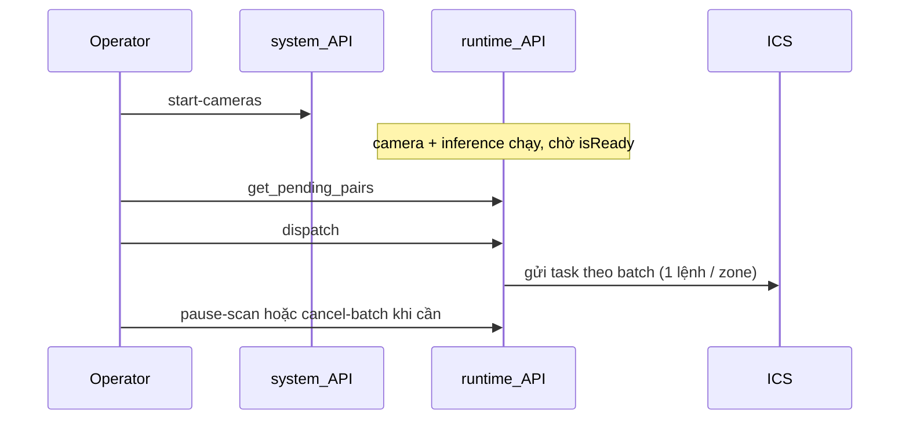

# Runbook — Runtime product

Vận hành runtime khi `RUNTIME_MODE=real` (camera / AI / ICS thật).  
Không dùng sandbox trên máy product.

**Thuật ngữ ngắn**

| Thuật ngữ | Nghĩa |
|-----------|--------|
| **Runtime** | Pipeline đang chạy trong process: inference + camera manager + pair manager + state RAM |
| **Degraded** | API CRUD/auth vẫn lên, nhưng runtime chưa sẵn → health 503 |
| **isReady** | Node start đã detect ổn định đủ thời gian → đủ điều kiện đưa vào batch gửi ICS |
| **Batch** | Tập start được chốt lúc `POST /runtime/dispatch`; chỉ các node trong batch được gửi ICS |
| **SYSTEM_CONTROL** | Quyền cần có để `start-cameras`, `dispatch`, `pause-scan`, `reload`, … |

---

## 1. Mục đích & phạm vi

- Checklist lên ca, khởi động, luồng operator, reload, recovery degraded, sự cố thường gặp, dừng an toàn.
- Lệnh điều khiển hệ thống cần user có quyền `SYSTEM_CONTROL` (thường `admin` / `operator` tùy seed).
- Sandbox (`RUNTIME_MODE=sandbox`) chỉ cho dev/demo — **cấm** trên product.

---

## 2. Checklist trước khi lên ca

- [ ] Mongo lắng nghe đúng `MONGODB_URL` / `MONGODB_DB` (product DB, **không** kết thúc `_sandbox`)
- [ ] NVIDIA GPU + CUDA + TensorRT + FFmpeg (NVDEC) sẵn sàng
- [ ] File model `.engine` tồn tại đúng `MODEL_PATH`
- [ ] `.env` product tối thiểu:
  - `RUNTIME_MODE=real`
  - `JWT_SECRET=` chuỗi cố định dài (không để trống — tránh logout mọi user sau mỗi restart)
  - `ICS_URL=` / các biến ICS site
  - `MODEL_PATH=` đường dẫn engine thật
- [ ] DB đã có cameras, pairs, nodes (priority / zone). Cảnh báo trong log nếu thiếu.
- [ ] ICS / AMR mạng tới được từ máy chạy API

---

## 3. Khởi động dịch vụ

Product: **không** dùng `--reload` (reload uvicorn tạo process mới, dễ rò GPU/VRAM).

```powershell
uv run uvicorn app:app --host 0.0.0.0 --port 5000
```

Sau khi process lên:

1. Login lấy Bearer token.
2. `GET /api/v1/system/get_health`  
   - Mong đợi: `status=ok`, `mongo=true`, `runtime_running=true`  
   - MediaMTX chỉ là report (thiếu binary không làm fail health).
3. `GET /api/v1/runtime/get_status`  
   - `running=true`  
   - `inference.paused` thường `true` ngay sau boot (engine start với `initial_paused=True`)  
   - `cameras.alive` / `enabled` phản ánh sau khi `start-cameras`

Nếu health 503 và `runtime_running=false` → xem mục 6 (degraded).

---

## 4. Luồng ca làm việc



### Bước chuẩn

| # | API | Việc xảy ra |
|---|-----|-------------|
| 1 | `POST /api/v1/system/start-cameras` | Bật stream camera + `inference.resume()`. Chờ model/stream theo `START_WAIT_*`. **Chưa** gửi ICS. |
| 2 | Chờ start `isReady` | Theo timer `START_READY_AFTER_SEC` + coverage/ROI. Theo dõi SSE `/api/v1/runtime/events` hoặc poll nodes. |
| 3 | `GET /api/v1/runtime/get_pending_pairs` | Xem trước batch / cặp sẽ gửi. |
| 4 | `POST /api/v1/runtime/dispatch` | Chốt batch theo col (head → tail) → mở cổng gửi ICS. |
| 5a | `POST /api/v1/runtime/cancel-batch` | Huỷ batch đang mở; **inference vẫn chạy**. |
| 5b | `POST /api/v1/runtime/pause-scan` | Pause inference + huỷ batch; cần `start-cameras` lại để detect tiếp. |

`dispatch` khi batch trước còn active → 409: chờ gửi hết hoặc `cancel-batch` / `pause-scan`.
Luật chốt batch / thứ tự gửi: [fe-api-dispatch-batch.md](./fe-api-dispatch-batch.md).

---

## 5. Thay đổi cấu hình giữa ca (reload)

Dùng `POST /api/v1/runtime/reload` khi đã sửa cameras / pairs / node priority trong Mongo và cần nạp lại **không** restart cả process.

Reload = `stop()` rồi `start()`:

- Inference tạo lại với **paused**
- Camera enabled về trạng thái sau start mới (cần `start-cameras` lại nếu muốn stream)
- Batch / scan session trong RAM mất

Sau reload thành công, lặp lại bước ca: `start-cameras` → `dispatch` → …  
Không spam reload khi lỗi GPU/VRAM — đợi dọn resource, đọc log, rồi thử một lần.

---

## 6. Degraded recovery

Triệu chứng: `GET /api/v1/system/get_health` → 503, `runtime_running=false` (API CRUD vẫn sống).

Nguyên nhân thường: model/GPU/TensorRT lỗi lúc `runtime_service.start()`, hoặc thiếu resource.

**Làm lần lượt**

1. Đọc `logs/app/log_*.log` — dòng `Runtime không khởi động được`
2. Đọc `logs/runtime_service/`, `logs/inference_engine/`, `logs/camera_manager/` / `logs/camera_processor/` / `logs/gpu_decoder/`
3. Sửa nguyên nhân (file engine, CUDA, Mongo cameras, VRAM)
4. `POST /api/v1/runtime/reload` (cần `SYSTEM_CONTROL`)
5. Verify lại `get_health` + `get_status`

`bind_runtime_control` giữ trước khi start — nên `/runtime/reload` vẫn gọi được khi start lần đầu thất bại.

---

## 7. Sự cố thường gặp

| Symptom | Check | Action |
|---------|--------|--------|
| `No camera streaming` (503) khi `start-cameras` | `get_status` → `cameras.enabled` / `alive` | Kiểm tra RTSP / NVDEC rồi gọi lại `POST /api/v1/system/start-cameras` |
| Dispatch: `Inference đang pause` (409) | `get_status.inference.paused` | `POST /api/v1/system/start-cameras` |
| Dispatch: `Batch trước chưa xong` (409) | Batch còn active | Chờ gửi hết, hoặc `cancel-batch` / `pause-scan` |
| Dispatch: `Chưa có start isReady` (409) | Detect / ROI / coverage / timer | Chờ ổn định; kiểm tra camera alive, ROI, `THRESHOLD_*` |
| `cameras.alive` thấp / không frame | RTSP, NVDEC, network | Log `camera_processor`, `gpu_decoder`; sửa URL/network rồi reload nếu cần |
| ICS không nhận task | `ICS_URL`, mạng, retry | Log dispatch / confirm; kiểm tra ICS site |
| Reload / start lỗi VRAM | Process cũ còn engine | Đừng spam reload; stop process sạch nếu cần, khởi động lại |
| Health mongo fail | Mongo down / URL sai | Sửa Mongo trước — runtime không thay thế được DB |
| Token hết hạn sau restart | `JWT_SECRET` trống | Set `JWT_SECRET` cố định trong `.env` product |

---

## 8. Dừng an toàn / hết ca

1. `POST /api/v1/runtime/pause-scan` — dừng detect, huỷ batch  
2. `POST /api/v1/system/stop_all` — tắt camera enabled  
3. Dừng process uvicorn (Ctrl+C / service stop)  
   - Lifespan gọi `runtime_service.stop()` theo thứ tự: pair_manager → camera_manager → inference_engine  
   - MediaMTX runner cũng stop

Không kill `-9` khi đang inference nếu có thể tránh — dễ để orphan GPU context.

---

## 9. Log cần mở

| Path | Khi nào xem |
|------|-------------|
| `logs/app/` | Boot, lifespan, runtime start fail (degraded) |
| `logs/runtime_service/` | Start/stop/reload, load cameras/pairs |
| `logs/inference_engine/` | Pause/resume, batch GPU, model |
| `logs/camera_manager/` | Start camera threads, enabled/alive |
| `logs/camera_processor/` | Per-camera decode / RTSP |
| `logs/gpu_decoder/` | NVDEC / first frame |
| `logs/confirm_dispatch/` | Confirm OK / reject reason |
| `logs/dispatch_gate/` / dispatch service logs | Cổng gửi ICS / gate |
| `logs/on_dispatch_success/` | Sau gửi ICS thành công |
| `logs/pending_pairs/` | Preview batch |

Retention: `LOG_KEEP_DAYS` (mặc định 5 ngày).
